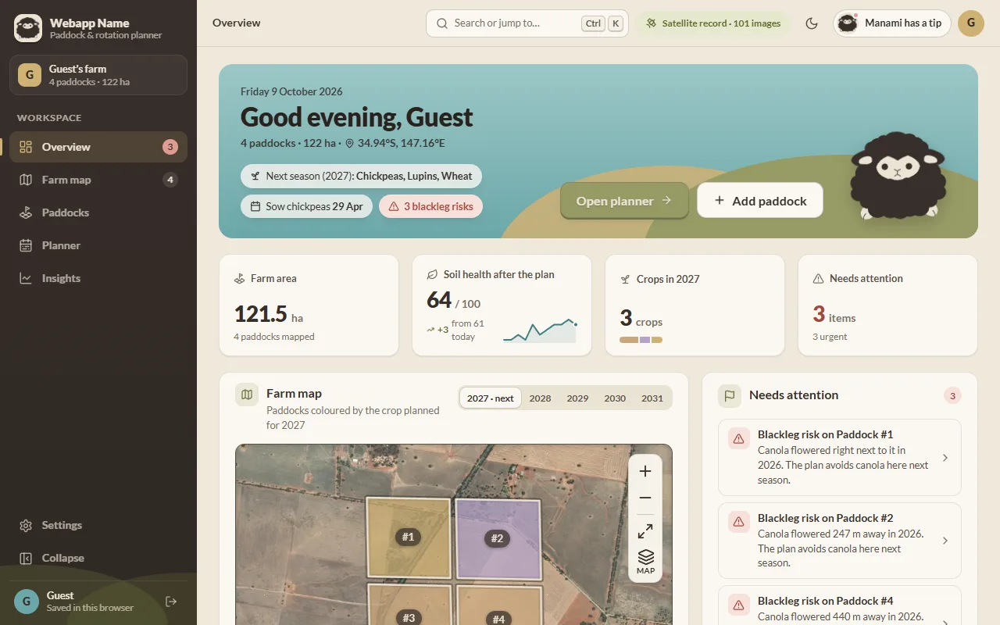

# TEAM SHEEEEP · paddock & crop-rotation planner

A web app that plans a farm's crop rotations from **the farm's own past, read from NASA
satellites**. Farmers draw their paddocks on a map. The app works out what grew in each
paddock over the last five seasons, adds soil, slope and 30 years of NASA weather, and plans
the next ten seasons. Manami the sheep guides them through it.

> **New to the team?** Do [Start here](#start-here) (about 10 minutes), then read
> [CONTRIBUTING.md](CONTRIBUTING.md) before your first change.



## Contents

1. [What it does](#what-it-does)
2. [Start here](#start-here)
3. [Team](#team)
4. [Where to find things](#where-to-find-things)
5. [Project structure](#project-structure)
6. [Commands](#commands)
7. [How we work](#how-we-work)
8. [Where we're up to](#where-were-up-to)

## What it does

Most rotation planners ask the farmer to type in what grew where, then guess. This one reads
the farm's history from space and uses it. Four features do the work:

| Feature | The farmer's problem | What the app does | NASA data |
| --- | --- | --- | --- |
| **Paddock Memory from Space** | Crop records are missing, especially on new or leased land. | Reads every clear satellite image of the last 5 seasons and names the crop family each season, with a confidence level. One click fills in the history. | HLS v2.0 (Landsat 8/9 + Sentinel-2) |
| **Neighbour canola → blackleg warning** | Blackleg spores blow in from last year's canola, including the neighbour's. | Finds flowering canola around the farm. Paddocks within 500 m get next season's canola steered elsewhere, with the reason. | HLS (yellow-flower index) |
| **Safest sowing window** | Too early risks frost at flowering, too late risks heat at grain fill. | Replays 30 years of daily temperatures for every sowing date and crop and shows the lowest-risk window. | POWER daily (T2M_MIN, T2M_MAX) |
| **"Did my rotation work?"** | Farmers rarely see proof that their rotation pays off. | Compares cereals grown after a break crop with cereals after cereals, using satellite vigour and rainfall. | HLS + POWER daily rain |

Everything runs in the browser: no backend, no login and no API keys (yet).

**Built with** React 19, Vite, React Router, Leaflet, Lucide icons, plain CSS with design
tokens (light and dark themes), and small SVG charts of our own. Data comes from NASA HLS
(through Microsoft Planetary Computer), NASA POWER, ISRIC SoilGrids, Open-Meteo, Esri and
OpenStreetMap. The full list is in [docs/how-it-works.md](docs/how-it-works.md#data-sources).

## Start here

You need **Git**, **Node.js 22** (the version is in [`.nvmrc`](.nvmrc)) and **Google Chrome**
(the browser checks drive it).

1. **Accept the GitHub invite.** The repo is private, so the owner adds you under
   *Settings → Collaborators*. Check your email or <https://github.com/notifications>.
2. **Get the code and start the app:**

   ```bash
   git clone https://github.com/AR13X3/team-sheeeep.git
   cd team-sheeeep
   npm install
   npm run dev
   ```

3. **Open <http://localhost:5173>** and press **Try the demo farm**. It loads four paddocks
   near Wagga Wagga (NSW) and goes straight to the Overview. The first satellite read takes
   about 30 seconds; after that it is cached.
4. **Read the tracker** at <http://localhost:5173/docs/tracker.html> while the dev server is
   running. It shows what's next, the open questions and every decision made so far.
5. **Switch to your own branch** (it's named after you; see [Team](#team)) and **fill in
   your row of the Team table** as your first pull request. It's a small, safe change that
   walks you through the whole branch → pull request → review flow in
   [CONTRIBUTING.md](CONTRIBUTING.md).

> Keep the project **outside** OneDrive, Dropbox or iCloud folders if you can.
> `node_modules/` holds thousands of files and syncing them is slow.

## Team

Everyone works on their own branch, named after them, and opens a pull request from it into
`main` whenever a task is done.

| Who | GitHub | Branch | Works on |
| --- | --- | --- | --- |
| Repo owner | [@AR13X3](https://github.com/AR13X3) | `ui-redo` for now | Everything so far: the app, the NASA features, the docs |

*New here? Fill in your row (GitHub handle, what you're working on) from your own branch, as your first pull request.*

## Where to find things

| I want to… | Open |
| --- | --- |
| See the app with screenshots, page by page | [`docs/readme.html`](docs/readme.html) |
| Know what's next, what's open and what was decided | [`docs/tracker.html`](docs/tracker.html) |
| Understand how a feature works (pages, data, accuracy, planner, design) | [`docs/how-it-works.md`](docs/how-it-works.md) |
| See how the four NASA features were planned and validated | [`docs/plan.html`](docs/plan.html) |
| Read the whole project end to end, including the 3-minute demo script | [`docs/TEAM-SHEEEEP-Project-Breakdown.docx`](docs/TEAM-SHEEEEP-Project-Breakdown.docx) |
| Learn how we branch, review and merge | [`CONTRIBUTING.md`](CONTRIBUTING.md) |
| Look at the original design | [`design/TEAM SHEEEEP.fig`](design/) (open in Figma) |

The `.html` pages are made to be **opened in a browser**: double-click the file, or visit
`http://localhost:5173/docs/<page>.html` while `npm run dev` is running. GitHub only shows
their source code.

## Project structure

```
team-sheeeep/
├── src/                      the app
│   ├── App.jsx               routes (hash router, pages load on demand)
│   ├── config.js             app name, mascot name, planning horizon, sowing date
│   ├── screens/              one file per page: Login, Dashboard, Planner, Insights…
│   ├── components/           shared pieces
│   │   ├── shell/            sidebar, top bar, Ctrl K search, Manami's panel
│   │   ├── ui.jsx            UI kit: buttons, cards, tabs, tables, toasts…
│   │   ├── charts.jsx        line, donut, bar and sparkline charts (SVG)
│   │   └── …                 map, paddock table, time-lapse, sowing card…
│   ├── logic/                the brains: rotation planner, crop-from-space classifier,
│   │                         sowing risk, rotation report, snapping, geometry, Manami's replies
│   ├── services/             talks to outside data: NASA HLS + POWER, SoilGrids,
│   │                         Open-Meteo, Nominatim (all cached)
│   ├── state/                farm store (saved in the browser), useFarm, data-loading hooks
│   ├── data/                 crop knowledge base, demo farm
│   ├── styles/               tokens.css (colours, light/dark) + one file per area
│   └── assets/               artwork exported from Figma: sheep, Manami, scenes, icons
├── docs/                     visual docs (readme, plan, tracker), how-it-works.md,
│                             the Word breakdown, screenshots in img/
├── tools/
│   ├── e2e/                  browser checks (npm run test:e2e) + doc screenshot script
│   ├── validation/           crop-from-space accuracy checks vs. USDA crop maps
│   ├── figma-export/         turns design/*.fig into the SVG artwork
│   └── docs/                 builds the Word breakdown
├── design/                   the Figma source file
├── public/                   files served as-is (favicon)
├── CONTRIBUTING.md           how we work together
└── CLAUDE.md                 project notes for Claude Code
```

New to the code? Start with [`src/App.jsx`](src/App.jsx) (every page and its route), then
[`src/state/useFarm.js`](src/state/useFarm.js) (where the plan, soil health and alerts come
together), then [`src/logic/rotation.js`](src/logic/rotation.js) (how a crop is chosen).

## Commands

| Command | What it does |
| --- | --- |
| `npm run dev` | Start the app at <http://localhost:5173> (also serves the docs at `/docs/…`) |
| `npm run build` | Production build into `dist/` |
| `npm run preview` | Serve the production build locally |
| `npm run test:e2e` | All browser checks. Needs `npm run dev` running. Add a word to run one, e.g. `npm run test:e2e -- fit` |
| `npm run validate:phenology` | Crop-from-space accuracy against USDA crop maps |
| `npm run validate:pixels` | Pure vs. all pixels on whole fields |
| `npm run validate:canola10m` | NASA HLS 30 m vs. Sentinel-2 10 m canola map |
| `npm run export:figma` | Re-export the artwork from `design/TEAM SHEEEEP.fig` |
| `node tools/e2e/_doc-shots.mjs` | Refresh the screenshots in `docs/img` (dev server running) |
| `python tools/docs/build_breakdown.py` | Rebuild the Word breakdown (needs `python-docx` and `Pillow`) |

## How we work

```
main  ──●────────────●──────────────●────   always works; what gets deployed
         \          ↗  \           ↗
sam       ●──●──●──●    ●──●──●──●          each member's own branch:
         \                         ↗        pull request → review → merge,
alex      ●──●──●──●──●──●──●──●──●          then merge main back in
```

1. Pick a task from **Next up** in the tracker and open (or assign yourself) a GitHub issue for it.
2. Switch to **your own branch** (named after you) and merge in the latest `main`.
3. Commit small, clear changes.
4. Run `npm run build` and the browser checks.
5. Open a pull request from your branch into `main`. A teammate reviews it, then it's merged
   with **Create a merge commit**.

Nobody pushes to `main` directly. Details, design rules and review tips are in
[CONTRIBUTING.md](CONTRIBUTING.md).

## Where we're up to

**Done:** the four NASA features (validated against USDA crop maps), and a full planning
workspace in the Figma theme: Overview dashboard, farm map editor, paddock pages, rotation
planner, insights and settings, in light and dark.

**Next:** hosting on Cloudflare Pages, then sign-in and cloud save (Supabase), a farm diary,
Manami with AI, and daily weather actions.

**Known limits:** there is no backend yet (sign-in only names a local profile), the app is
still called "Webapp Name" (`src/config.js`, `index.html`), prices are example values, and
the classifier was validated in North Dakota rather than Australia.

The live list of tasks, open questions and decisions is in [the tracker](docs/tracker.html).
